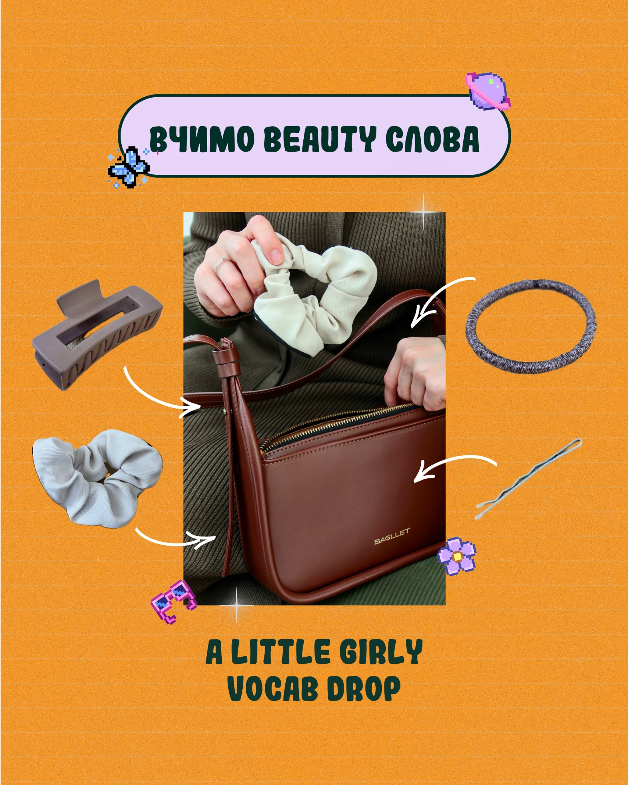

# Orange vocab post with lavender pill, arrows and pixel icons

**Discipline:** print-social ·  · **Design style:** Retro & Pixel
**Tags:** education, orange, lavender-pill, pixel-art, arrows, photo-centre, grain, cyrillic

## What it is
A 4:5 post on grainy orange paper. A lavender pill with dark green border holds the title. A centred photo of a bag and scrunchie is surrounded by cut-out hair accessories with white curved arrows pointing to details, pixel art butterfly, flower and sunglasses stickers, and a two-line green caption below.

## What it means
Girly, playful and instructive; arrows make it work like an annotated diagram.

## Techniques
- Point curved white arrows from isolated objects to the photo details they name.
- Use warm orange with dark green type for a distinctive earthy-pop palette.
- Mix pixel-art stickers with real photos.
- Add fine horizontal grain lines to imitate paper.

## Best for
- Vocabulary and how-to carousels
- Fashion and accessory brands
- Annotated product explainers

## Vocabulary
- **Annotation arrow** — A hand-drawn arrow linking a label or object to a detail.
- **Earthy-pop palette** — Mixing earth tones with bright pastels.
- **Paper grain** — Fine noise lines mimicking printed paper.
- **Object ring** — Items arranged around a central image.
