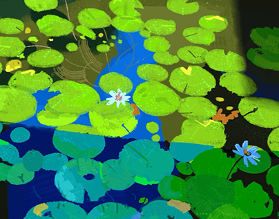

# Painterly lily pond with lime lily pads, blue water and two small flowers

**Discipline:** print-social · **Design type:** Editorial illustration · **Design style:** Playful & Illustrated
**Tags:** illustration, nature, lily-pads, green, blue, painterly

## What it is
A flat-perspective digital painting of a pond filled with overlapping lily pads in lime, teal and olive, deep blue water shapes, a white and a blue water lily, orange floating leaves and loose brush marks.

## What it means
Calm and lush; saturated flat shapes feel like a modern take on Monet.

## Techniques
- Build a scene from overlapping flat shapes.
- Use a top-down view to make pattern out of nature.
- Add two small flowers as focal accents.

## Best for
- Editorial spot art
- Textile and wallpaper patterns
- Wellness brand visuals

## Vocabulary
- **Top-down view** — Looking straight down on a scene.
- **Painterly** — Showing visible brush marks.
