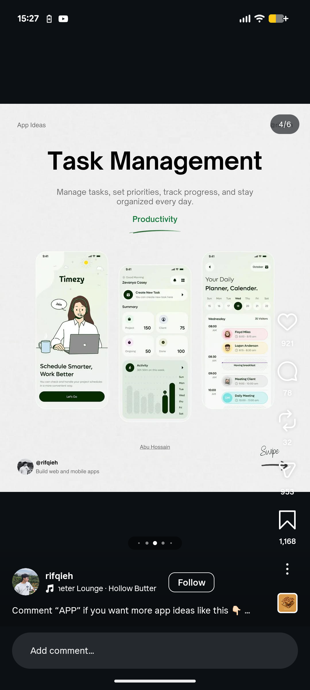

# App Ideas Task Management Carousel Slide

**Discipline:** print-social · **Design type:** Social carousel
**Tags:** carousel, app-ideas, pale-grey, green, phones, serif-underline, productivity

## What it is
A pale grey grainy carousel slide with a small App Ideas label, a huge black 'Task Management' title, a grey description, a green 'Productivity' word with a hand-drawn underline, three cream-green phones (an illustrated welcome, a summary with bars and a daily planner), a credit line and a swipe hint.

## What it means
A restrained grey ground with green-tinted phones feels calm, and a hand-drawn underline adds a human touch.

## Techniques
- Huge black title over grey paper grain
- Green as the sole accent colour
- Three phones in a row at different heights
- Hand-drawn underline under a keyword
- Author credit and swipe hint at the base

## Best for
- App idea showcase carousels
- Designer content posts
- Calm three-phone layouts

## Vocabulary
- **Idea card** — A slide presenting one app concept.
- **Hand-drawn underline** — A loose line drawn under a word for emphasis.
- **Paper grain** — Fine noise over a flat colour for a paper feel.
