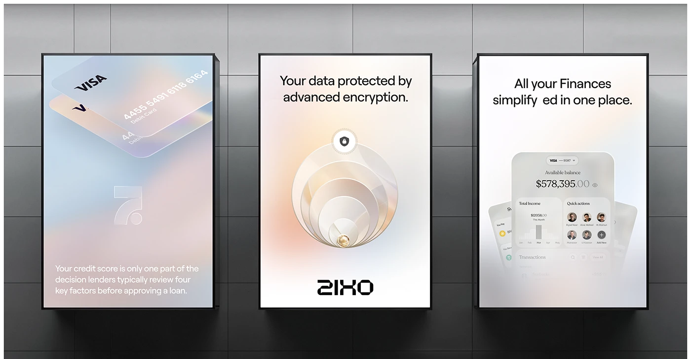

# Pastel Glass Billboard Triptych

**Discipline:** print-social ·  · **Design style:** Glassmorphism
**Tags:** billboards, pastel, glass, encryption, cards, light-boxes, fintech

## What it is
Three lightbox posters on a grey tiled wall: glass debit cards on a pastel blue and peach gradient with a credit score note, concentric glass discs with a lock and the line 'Your data protected by advanced encryption', and a frosted banking app phone with 'All your finances simplified in one place'.

## What it means
Frosted pastel gradients feel secure yet gentle, and each poster illustrates its message with a glassy object.

## Techniques
- Glass objects as the hero of each poster
- Pastel peach and blue gradient fields
- Short centred headline at the top
- Wordmark sign-off at the base
- Lightbox frames on a neutral wall

## Best for
- Fintech out-of-home
- Security messaging
- Glassmorphism campaigns

## Vocabulary
- **Lightbox poster** — A backlit poster in a box frame.
- **Concentric discs** — Nested circles used to suggest layers of protection.
- **Glass object** — A translucent 3D shape used as an illustration.
