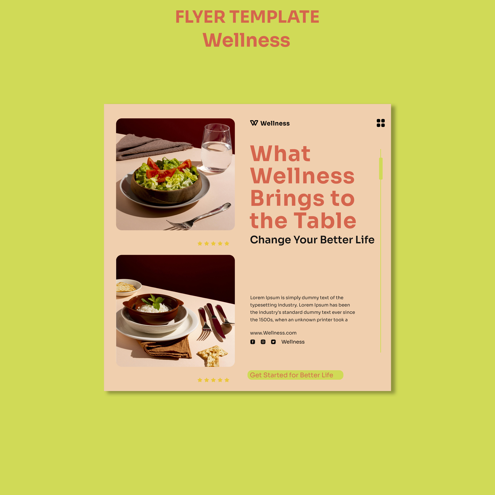

# Peach and Lime Wellness Flyer Template

**Discipline:** print-social · **Design type:** Promo flyer
**Tags:** flyer, template, peach, lime, food, coral, square

## What it is
A square flyer template presented on chartreuse: a peach sheet with two rounded food-still-life photos on the left, a large coral headline 'What Wellness Brings to the Table', a black subhead, body copy, contact icons and a lime pill call-to-action.

## What it means
Peach, coral and lime feel appetising and healthy, and the moody dark-red photo backgrounds add sophistication.

## Techniques
- Two stacked rounded photos as a left column
- Coral heading in heavy sans against a peach ground
- Vertical lime slider line as a decorative detail
- Lime pill CTA at the base
- Template shown on a contrasting chartreuse background

## Best for
- Wellness, food and lifestyle flyers
- Editable social and print templates
- Simple two-column promotional layouts

## Vocabulary
- **Template presentation** — A layout shown on a contrasting field for marketplace listings.
- **Photo column** — Images stacked vertically beside the text.
- **Pill CTA** — A rounded button-shaped call to action.
