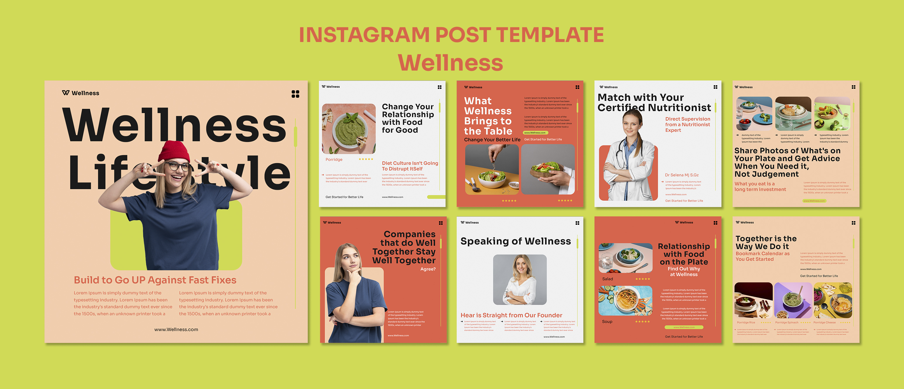

# Peach and Coral Wellness Post Template Set

**Discipline:** print-social · **Design type:** Social template pack
**Tags:** templates, wellness, peach, coral, food, portraits, instagram, chartreuse

## What it is
A template presentation on chartreuse with one large peach cover post ('Wellness Lifestyle' with a cut-out woman in a red beanie over a lime rounded square) and eight smaller square posts alternating peach, coral and white with food photography and portraits.

## What it means
Alternating background colours across posts create a lively grid, and consistent type and small brand marks keep it one family.

## Techniques
- Cut-out person overlapping giant headline letters
- Alternating three background colours across the feed
- Rounded photo blocks and rounded lime accent shapes
- Vertical slider line motif on each post
- Star-rating icons and pill CTAs as repeatable details

## Best for
- Wellness, nutrition and lifestyle brands
- Editable Instagram template packs
- Feed grids that need rhythm

## Vocabulary
- **Cover post** — The large post that introduces a template set.
- **Colour rotation** — Cycling background colours across a series.
- **Overlap headline** — A person or object placed partly over large type.
