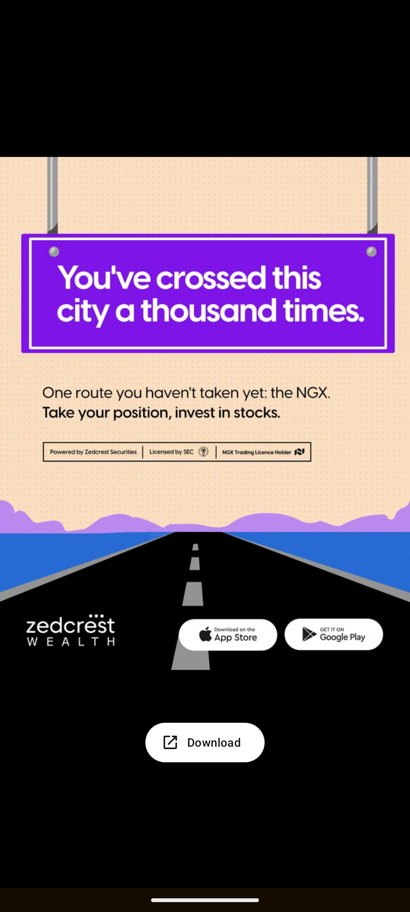

# Highway Sign Invest in Stocks Illustrated Ad

**Discipline:** print-social ·  · **Design style:** Playful & Illustrated
**Tags:** ad, peach, purple, highway-sign, road, illustration, store-badges, finance

## What it is
A portrait ad on dotted peach with two grey poles holding a bright purple highway sign with a white border reading 'You've crossed this city a thousand times.', a line 'One route you haven't taken yet: the NGX. Take your position, invest in stocks.', a boxed licence strip, purple hills, a blue horizon and a black road with dashed lines, and the wordmark with App Store and Google Play badges.

## What it means
Turning the ad into a road sign makes a familiar object carry a fresh idea, and a flat illustrated road leads the eye to the download buttons.

## Techniques
- Copy set on an illustrated highway sign
- Road with vanishing perspective leading to the CTA
- Flat layered hills and horizon bands
- Boxed licence and trust line
- Store badges as the base call to action

## Best for
- Fintech and investment ads
- Metaphor-led campaigns
- Flat illustrated social ads

## Vocabulary
- **Sign mockup** — Copy placed on an illustrated road or street sign.
- **Vanishing perspective** — Lines converging toward a point on the horizon.
- **Trust strip** — A boxed line stating licences and partners.
