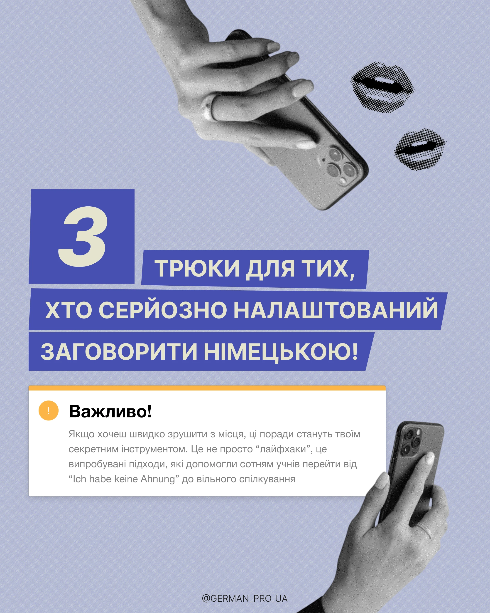

# Tips cover with slanted blue label blocks, greyscale hands with phones and halftone lips

**Discipline:** print-social · **Design type:** Social educational post
**Tags:** tips, periwinkle, label-blocks, greyscale-cutout, halftone, note-card, grain, cyrillic

## What it is
A grainy periwinkle 4:5 post with a big blue square holding a cream numeral '3', slanted blue label blocks with cream caps for the title, two greyscale hands holding phones, two halftone lips, and a white note card with an orange top edge and warning badge.

## What it means
Clear and modern-collage; label blocks feel like cut-out tape.

## Techniques
- Set each line of the headline on a slanted colour block.
- Use a giant numeral in a square as the entry point.
- Add greyscale halftone cut-outs as collage elements.
- Use a white note card with a coloured top border for the key message.

## Best for
- Numbered tip carousels
- Education and language accounts
- Collage-style covers

## Vocabulary
- **Slanted label blocks** — Text rectangles with angled ends.
- **Halftone cutout** — A photo rendered in dots and cut out.
- **Numeral tile** — A large number in a coloured square.
- **Note card** — A white card highlighting a key message.
