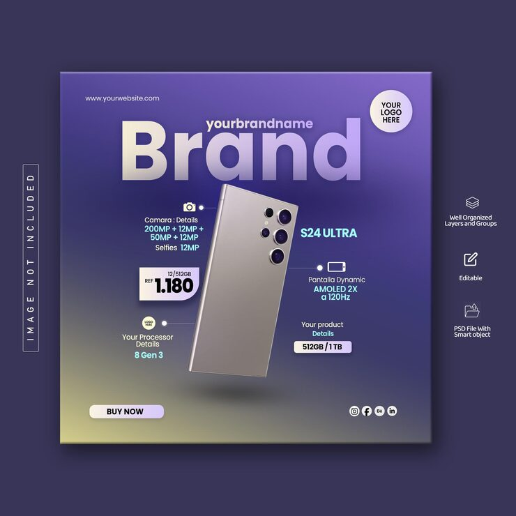

# Purple gradient smartphone product ad

**Discipline:** print-social · **Design type:** Social ad · **Design style:** Gradient & Aurora
**Tags:** product ad, smartphone, gradient, purple, spec callouts, ecommerce

## What it is
A square ad for a flagship phone tilted at an angle over a soft purple-to-green gradient, with spec callouts for camera, screen and processor placed around it.

## What it means
Angling the product and scattering short spec tags around it (rather than a dense spec sheet) keeps the ad feeling premium and easy to scan at a glance.

## Techniques
- tilt the hero product off-axis for dynamism instead of a flat frontal shot
- place short spec callouts in loose orbit around the product rather than in a table
- use an ambient color gradient background instead of a solid or photographic backdrop

## Best for
- e-commerce product ads
- tech retailer social promos
- flash-sale campaign graphics

## Vocabulary
- **callout** — a short label pointing to a specific detail or feature within a larger image
