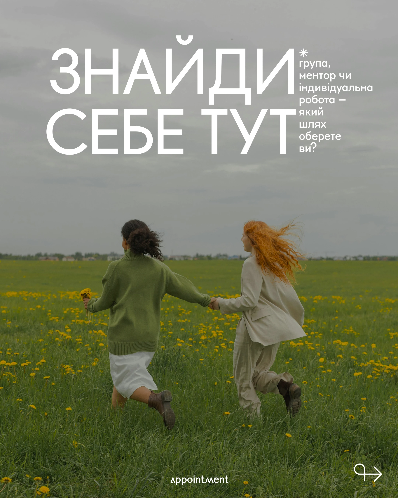

# Darkened photo cover with huge light caps and a side caption

**Discipline:** print-social · **Design type:** Social cover post
**Tags:** cover, photo-overlay, thin-caps, field, green, cyrillic, two-runner, logo

## What it is
A 4:5 post with a darkened photo of two women running through a meadow. A giant white light-weight two-line headline sits at the top with a narrow caption to its right marked by an asterisk, a small wordmark at the bottom and an arrow glyph in the corner.

## What it means
Open, hopeful and calm; the running figures bring movement and the thin type feels premium.

## Techniques
- Darken a natural photo so white type reads.
- Set a huge light-weight headline and a slim side caption.
- Use an asterisk as a bullet for the caption.
- Place a small logo at the bottom centre and a directional glyph at the corner.

## Best for
- Wellness, therapy and coaching covers
- Editorial-style Instagram posts
- Carousel opening slides

## Vocabulary
- **Photo overlay** — A dark tint over a photo for text legibility.
- **Thin caps** — Uppercase type in a light weight.
- **Side caption** — A narrow column of text beside a headline.
- **Directional glyph** — An arrow mark suggesting the next slide.
