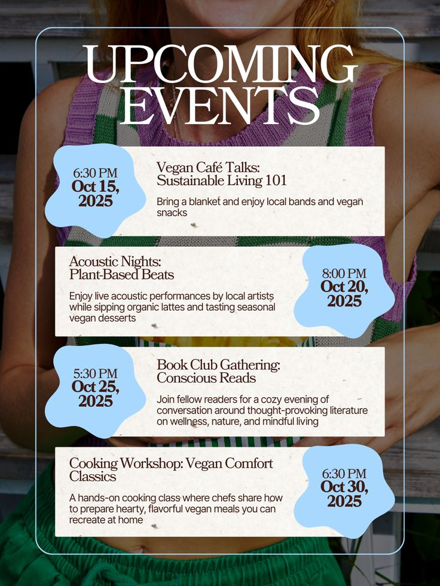

# Upcoming Events with Paper Cards and Blob Dates

**Discipline:** print-social · **Design type:** Event flyer
**Tags:** events, serif, cream-paper, blue-blobs, photo, list, vegan

## What it is
A portrait flyer over a cropped photo of a person in a knit top with a thin outline frame, a giant white serif title 'UPCOMING EVENTS' and four cream paper cards listing events, each with a sky-blue blob holding the time and date, alternating left and right.

## What it means
Organic blue blobs and textured paper cards feel friendly and crafted, and alternating sides gives a list rhythm.

## Techniques
- Blob shapes carrying dates alternating sides
- Cream paper texture cards over a photo
- Giant white serif headline
- Thin outline frame inside the canvas
- Bold date and light description in each card

## Best for
- Event listings and schedules
- Community and lifestyle events
- Photo-backed list posters

## Vocabulary
- **Date blob** — An organic shape holding a date and time.
- **Paper card** — A card with a paper-like texture.
- **Alternating list** — Items placed left then right down a page.
