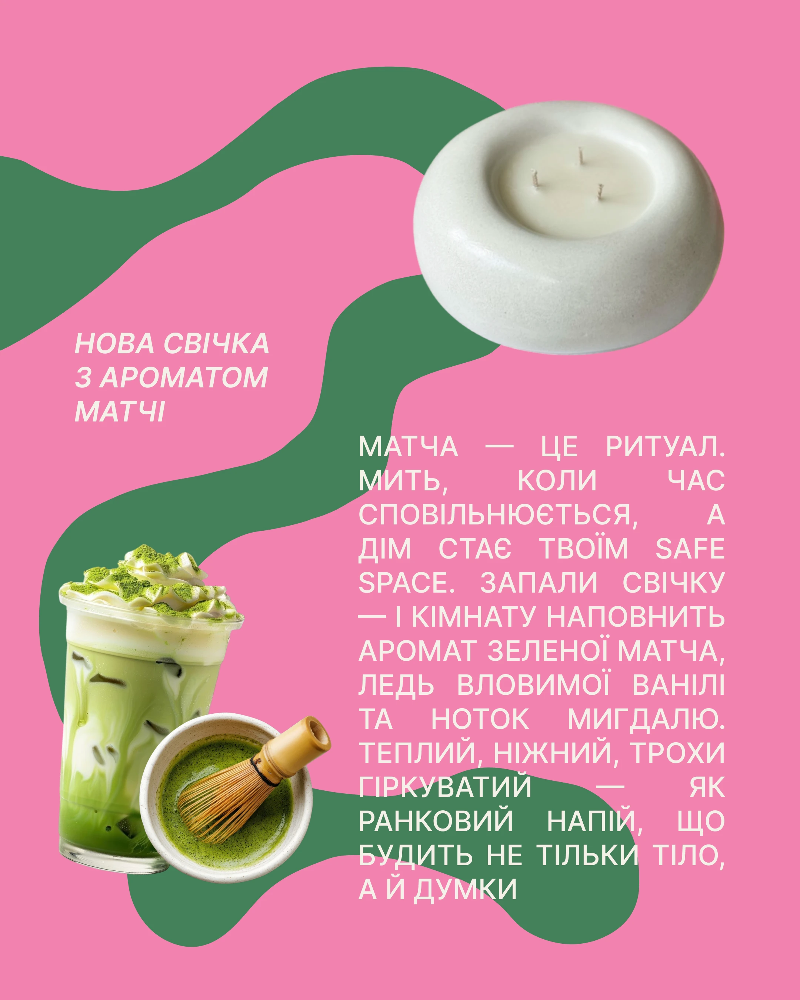

# Bubblegum pink post with green blob paths, matcha drink cutouts and justified caps

**Discipline:** print-social · **Design type:** Social promo post
**Tags:** product-launch, pink, green, blob-shapes, candle, matcha, justified-text, cyrillic

## What it is
A pink 4:5 post with thick winding dark-green blob shapes running through it. A white round candle sits at the top right, a matcha latte and whisk bowl cutout at bottom left, an italic caps title at left and a large justified paragraph in cream caps at lower right.

## What it means
Playful and sensory; pink and green feel like a matcha treat.

## Techniques
- Use organic winding shapes as a path between cutouts.
- Choose a complementary pink and green pair.
- Set the body as large justified caps with wide spacing.
- Add italic caps for the small title.

## Best for
- Product launch posts for candles, food and beauty
- Posts with several cutout photos
- Bold two-colour palettes

## Vocabulary
- **Blob path** — A thick organic shape that leads the eye.
- **Justified caps** — Uppercase text aligned on both edges.
- **Colour complement** — Opposite hues used together.
- **Cutout cluster** — Several removed-background objects grouped.
