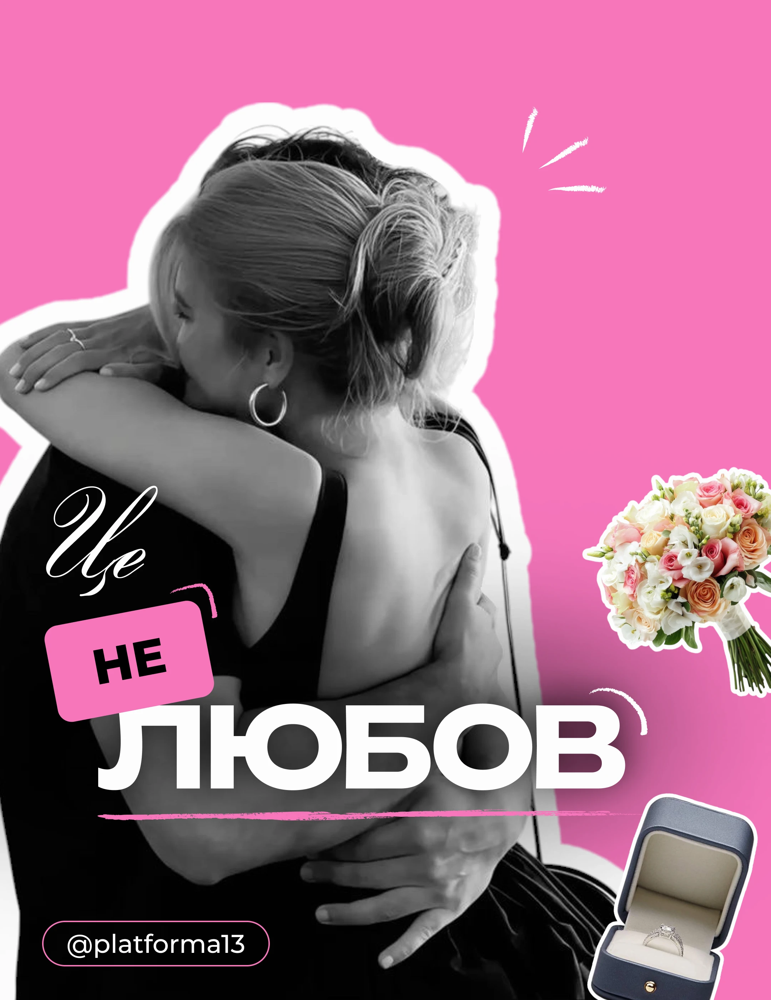

# Hot-pink post with a greyscale embrace cutout, giant white caps, script and bouquet and ring stickers

**Discipline:** print-social ·  · **Design style:** Playful & Illustrated
**Tags:** relationships, pink, greyscale, cutout, white-outline, script, stickers, cyrillic

## What it is
A hot-pink portrait post with a black-and-white photo of two people hugging cut out with a thick white outline, a flourished script 'Це', a tilted pink label 'НЕ', giant white extended 'ЛЮБОВ', a pink brush underline, white spark lines, a colour bouquet and a ring box sticker and a handle pill.

## What it means
Emotional and punchy; mono photo plus hot pink and colour props tell a story.

## Techniques
- Outline a mono cutout in thick white.
- Stack script, label and giant caps.
- Add colour object stickers (bouquet, ring) as punchlines.
- Use spark strokes and brush underline.

## Best for
- Relationship and psychology content
- Statement covers
- Sticker-and-cutout layouts

## Vocabulary
- **White cut outline** — A thick white border around a cutout.
- **Word stack** — Script, label and giant caps combined.
- **Object punchline** — A colourful object adding meaning.
- **Brush underline** — A rough painted stroke under text.
