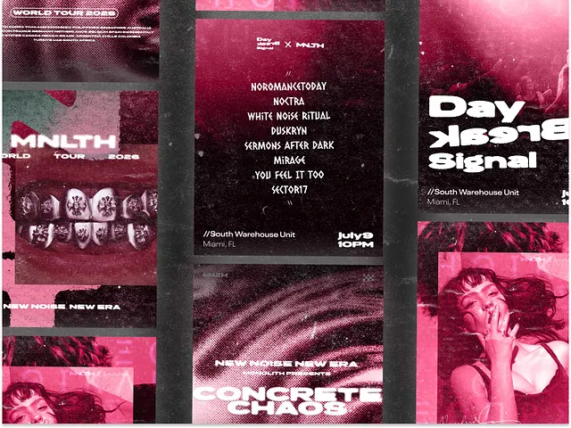

# Hot-pink and black gig posters with halftone grain, stamped type and chrome teeth

**Discipline:** print-social · **Design type:** Event poster
**Tags:** music, posters, pink, black, halftone, grain, grunge, tour

## What it is
A collage of several gig posters in pink-black duotone: a line-up list in a bold stamped face, a giant bold-outlined 'Day Break Signal', a close-up of chrome grills, a smoky blur 'Concrete Chaos' and a portrait with a cigarette, all with coarse grain and halftone.

## What it means
Raw and loud; grain and duotone feel like photocopied flyers.

## Techniques
- Duotone every photo in pink and black.
- Add halftone and heavy grain.
- Set lineups in stamped condensed type.
- Flip or distort letters for chaos.

## Best for
- Music and club posters
- Underground brand identities
- Photocopy-style graphics

## Vocabulary
- **Pink duotone** — A photo rendered in pink and black.
- **Photocopy grain** — Coarse noise imitating copier texture.
- **Lineup list** — A stacked list of performers.
- **Mirrored letters** — Letters flipped for a distorted effect.
