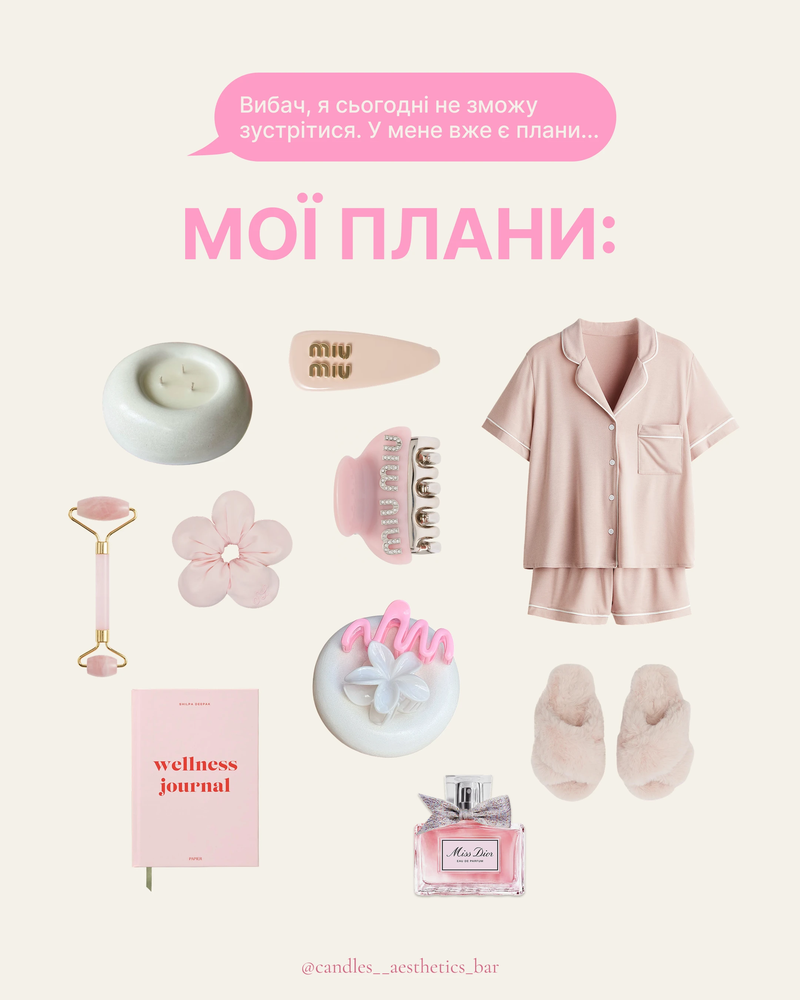

# Cream post with a pink chat bubble excuse, big pink 'MY PLANS:' and a scattered flat lay of pink self-care objects

**Discipline:** print-social ·  · **Design style:** Warm & Organic
**Tags:** flat-lay, pink, cream, chat-bubble, self-care, cutouts, candle, cyrillic

## What it is
A cream portrait with a pink message bubble ('Sorry, I can't meet today. I already have plans...'), a giant pink extended 'МОЇ ПЛАНИ:' and a scatter of cutout pink and white objects: candle bowl, hair claws, scrunchie, jade roller, pyjamas, slippers, journal and perfume, with a handle at the bottom.

## What it means
Cosy and witty; a texted excuse is answered by a pile of comforting objects.

## Techniques
- Open with a chat bubble as setup.
- Scatter cutout objects in one colour family.
- Use a bold pink headline on cream.
- Keep the layout loose and airy.

## Best for
- Lifestyle and candle brand posts
- Relatable meme-style content
- Single-colour cutout collages

## Vocabulary
- **Chat-bubble setup** — A message bubble that frames the joke.
- **Cutout scatter** — Objects with backgrounds removed arranged loosely.
- **Colour family** — Objects in shades of one hue.
- **Airy layout** — A layout with generous space between elements.
