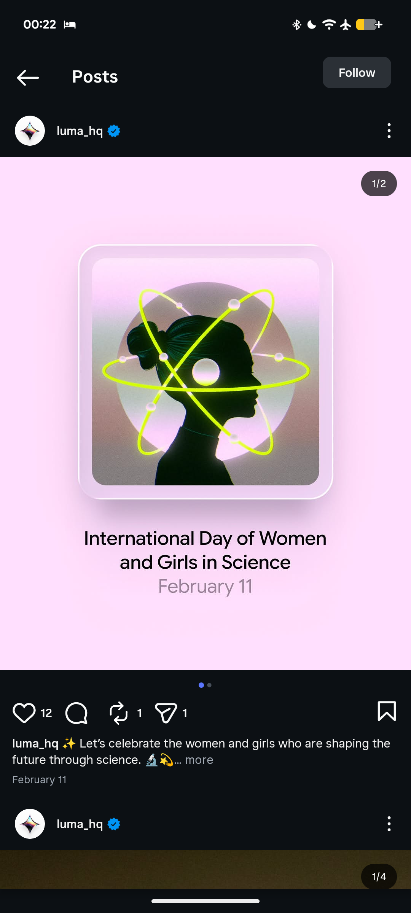

# Silhouette with Neon Atom Awareness Day Post

**Discipline:** print-social · **Design type:** Social promo post
**Tags:** awareness-day, pink, silhouette, neon-lime, atom, frosted-frame, science, instagram

## What it is
An Instagram carousel slide on soft pink with a frosted glass frame around a dusky gradient circle holding a dark side-profile silhouette of a woman crossed by glowing lime atom orbits, and a centred two-tone caption 'International Day of Women and Girls in Science, February 11'.

## What it means
Neon orbits around a head turn an abstract idea into an emblem, and the pale pink frame keeps it gentle.

## Techniques
- Silhouette wrapped by glowing orbit lines
- Frosted rounded frame around the artwork
- Pink field with one neon lime accent
- Centred sentence-case caption with a dimmed date
- Soft gradient circle behind the figure

## Best for
- Awareness day and cause posts
- Science and education content
- Illustration-led social slides

## Vocabulary
- **Orbit lines** — Elliptical strokes circling a subject like an atom model.
- **Frosted frame** — A translucent bordered panel around an image.
- **Dimmed date** — A date set in a lighter tone than the title.
