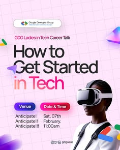

# Tech career talk flyer on pink grid paper with a VR-headset portrait

**Discipline:** print-social · **Design type:** Event flyer
**Tags:** event, flyer, pink, grid-paper, vr-headset, pills, stickers, women-in-tech

## What it is
A pale pink squared-paper flyer with a logo pill at top, a small ladies-in-tech tag, a huge 'How to Get Started in Tech' in black with 'Tech' in gradient blue, blue and pink info pills for venue and date, and a cut-out portrait of a woman wearing a white VR headset. Colourful chevron shapes peek from the sides.

## What it means
Fresh, energetic and inclusive; the headset gives a clear tech signal.

## Techniques
- Use a soft pink grid background with multi-colour chevron accents.
- Contrast heavy black title text with one gradient word.
- Use coloured pills for logistics.
- Choose a cutout portrait holding a tech prop.

## Best for
- Women-in-tech and community events
- Career talks and workshops
- Youth-oriented tech flyers

## Vocabulary
- **Gradient word** — One word with a colour gradient inside a headline.
- **Chevron accent** — An arrow-shaped decorative element.
- **Prop portrait** — A portrait with an object that signals the topic.
- **Grid paper** — A ruled-square background.
