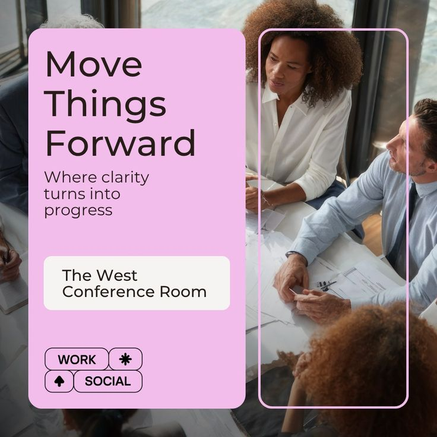

# Pink Panel Conference Room Post

**Discipline:** print-social ·  · **Design style:** Playful & Illustrated
**Tags:** pink, panel, photo, meeting, outline-frame, tags, square

## What it is
A square post with a large soft pink rounded panel carrying a light headline 'Move Things Forward', a subline, a white room-name box and outlined tag pills, beside an overhead meeting photo with a thin pink outlined frame.

## What it means
A pastel panel over a real photo feels friendly and modern for workplace communication, and the outline frame adds a designed accent.

## Techniques
- Solid pink panel covering half the photo
- Thin outline frame over the photo
- Light large headline with a small subline
- Outlined tag pills with icons
- White info box for the key detail

## Best for
- Workplace and office communications
- Room and event announcements
- Social posts with a photo and panel split

## Vocabulary
- **Colour panel** — A solid rounded block laid over an image to hold text.
- **Outline frame** — A thin line rectangle drawn over a photo.
- **Tag pill** — An outlined rounded label with an icon.
