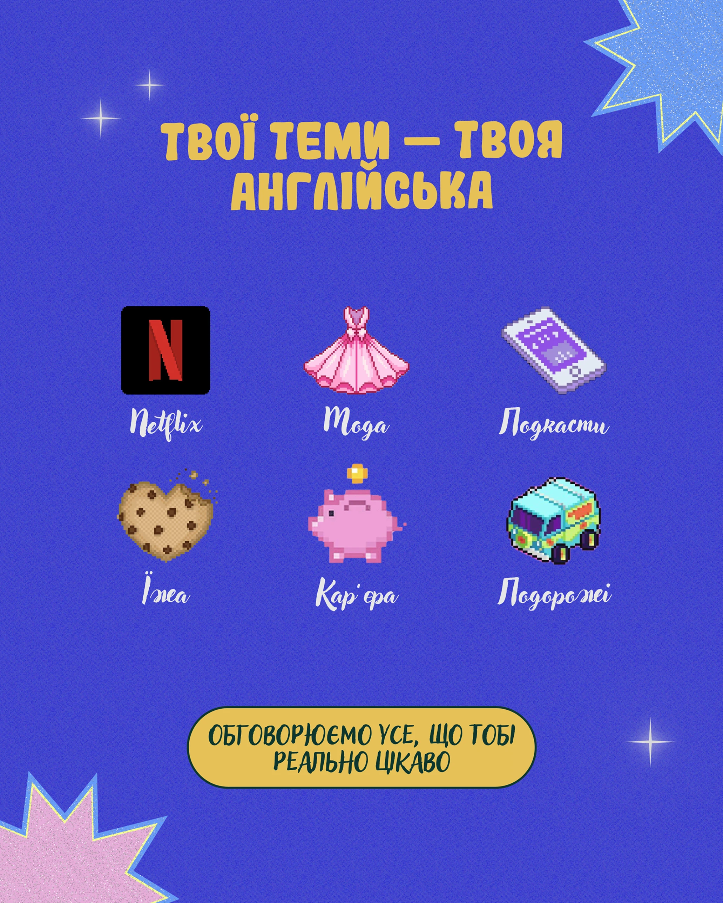

# Cobalt grainy post with six pixel-art topic icons, script labels, glitter starbursts and a yellow pill

**Discipline:** print-social ·  · **Design style:** Retro & Pixel
**Tags:** language, pixel-art, cobalt, yellow, script, glitter, icons, cyrillic

## What it is
A grainy cobalt post with a yellow rounded title, six pixel-art icons (Netflix, dress, phone, cookie heart, piggy bank, van) with white script labels below, glitter starbursts and sparkles in the corners and a yellow pill with dark green text at the bottom.

## What it means
Cute and inviting; pixel icons make topics feel like game items.

## Techniques
- Show topics as pixel-art icons in a 2x3 grid.
- Label with white script.
- Use yellow title and pill.
- Add glitter starbursts.

## Best for
- Language topic menus
- Pixel-style education posts
- Cobalt and yellow palettes

## Vocabulary
- **Pixel icon grid** — Pixel-art items arranged in a grid.
- **Script label** — A handwritten-style caption.
- **Glitter starburst** — A star with sparkle texture.
- **Yellow pill** — A yellow capsule holding a line of text.
