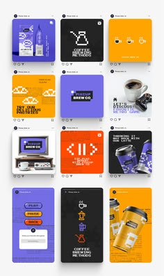

# Retro-game coffee brand feed with pixel icons in violet, orange, yellow and black

**Discipline:** print-social · **Design type:** Feed mockup
**Tags:** instagram, feed-grid, pixel-art, retro-game, coffee, violet, orange, yellow

## What it is
A 3x4 Instagram grid of square posts with pixel-art coffee cups, coffee makers, clouds and 8-bit gadgets. Colours alternate violet, orange, yellow and black, with pixel fonts for messages like 'Coffee brewing methods' and packaging renders of cans and cups.

## What it means
Nostalgic and playful; game imagery makes coffee content feel like an arcade.

## Techniques
- Draw all icons on a strict pixel grid.
- Rotate through four flat background colours.
- Use pixel type for headings.
- Mix pixel graphics with realistic product renders.

## Best for
- Coffee and food brands with a gamer audience
- Pixel-style social systems
- Retro-tech themes

## Vocabulary
- **Pixel grid** — A strict square grid for drawing blocky art.
- **8-bit style** — A retro game look with limited colours and blocky shapes.
- **Colour rotation** — Cycling backgrounds through a set of colours.
- **Pixel type** — A typeface built from squares.
