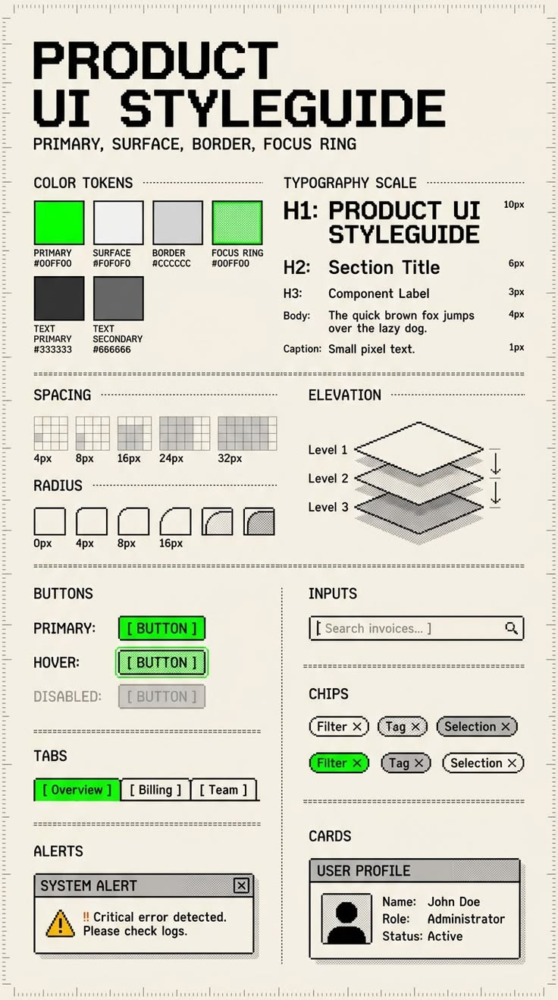

# Pixel Retro Product UI Styleguide Poster

**Discipline:** print-social ·  · **Design style:** Retro & Pixel
**Tags:** pixel, retro, styleguide, green, cream, monospace, tokens, infographic

## What it is
A cream poster in pixel type titled 'PRODUCT UI STYLEGUIDE' with dotted-rule sections for colour tokens, typography scale, spacing, radius, elevation layers, buttons, inputs, chips, tabs, alerts and cards, in black, greys and neon green.

## What it means
Retro pixel styling makes a dry spec feel like a game manual, while neon green marks the primary actions.

## Techniques
- Pixel typeface for headings
- Dotted leader lines after section titles
- Isometric stacked planes for elevation
- Chunky black outlines on every component
- Neon green as the only saturated colour

## Best for
- Design-system posters with personality
- Retro-styled documentation
- Educational infographics

## Vocabulary
- **Design tokens** — Named values for colour, spacing and type used across a system.
- **Elevation levels** — Steps of visual height shown by stacked planes.
- **Pixel type** — Lettering built from visible square pixels.
