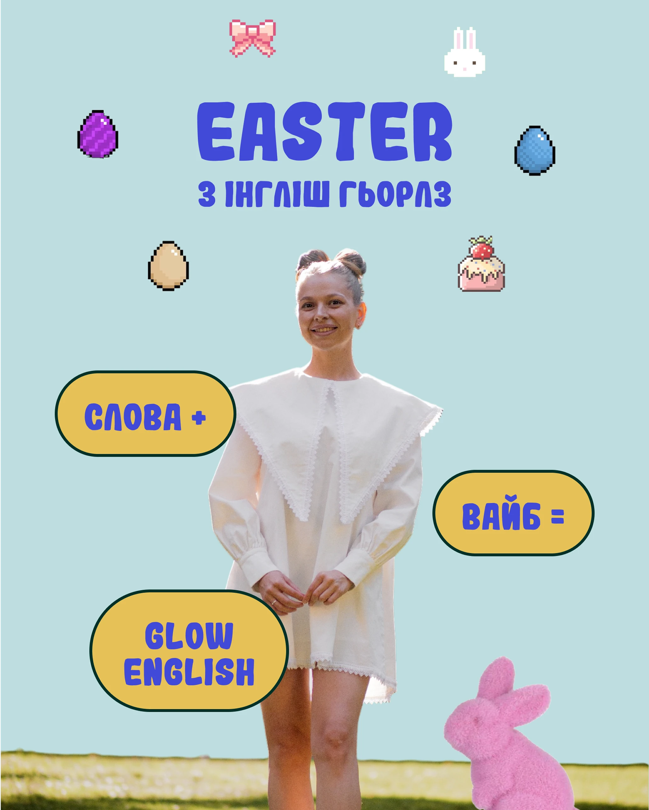

# Pastel Easter cover with pixel-art stickers and pill labels

**Discipline:** print-social ·  · **Design style:** Retro & Pixel
**Tags:** social-media, carousel, easter, pixel-art, pastel, pill-labels, cutout, bubble-type, cyrillic

## What it is
A 4:5 portrait cover on flat powder blue. A cut-out photo of a woman in a big-collar dress stands centre. Chunky blue rounded display type says EASTER at the top. Pixel-art eggs, a bunny, bow and cake float around her. Three mustard pill-shaped labels with dark outlines carry short phrases, and a fuzzy pink bunny toy peeks from the corner.

## What it means
Cute, playful and seasonal: it feels like a game or a Tamagotchi mixed with a real person, warm and youthful without being childish.

## Techniques
- Mix retro pixel-art icons with a real cut-out photo so digital nostalgia meets human warmth.
- Use fat rounded display lettering in one saturated blue for a friendly, toy-like voice.
- Turn text into pill-shaped buttons with thick dark outlines that read as UI chips or stickers.
- Keep the palette to powder blue, mustard, violet-blue and pink, all soft and matte.
- Scatter small icons symmetrically around the subject to frame her without crowding.

## Best for
- Seasonal social campaigns and holiday carousels
- Education, language and lifestyle creators with young audiences
- Posters and event flyers with a playful gaming twist

## Vocabulary
- **Pixel-art icon** — A small illustration drawn on a visible pixel grid, evoking early games.
- **Pill label** — A rounded capsule shape holding short text, like a button or sticker.
- **Bubble type** — Fat rounded letterforms with a soft, inflated look.
- **Cutout portrait** — A photo with its background removed to sit on a flat colour.
