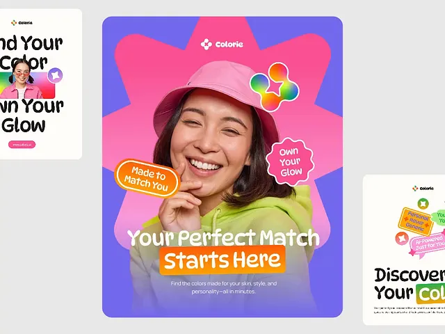

# Colorful Sticker-Badge Ad Poster Set

**Discipline:** print-social · **Design type:** Social template pack
**Tags:** playful, stickers, poster, gradient, rounded-type, portrait, campaign

## What it is
A trio of vertical brand posters: a central one with a smiling woman in a pink bucket hat on a purple field with a pink starburst, overlapping badge stickers and a bold rounded headline, flanked by cropped sibling layouts on cream.

## What it means
Bright saturated color, chunky rounded type and pill-shaped stickers create a friendly, energetic tone that feels youthful and beauty-adjacent. The set shows a coherent system, not a single one-off.

## Techniques
- Cut-out photo layered over a large starburst shape for pop and depth
- Scatter wavy-edged and pill-shaped sticker badges at tilted angles
- Highlight part of the headline with a solid orange block
- Show the same system in different color backgrounds (purple, cream) to prove flexibility
- Cropped edges of neighbor cards to imply a larger series

## Best for
- Beauty, lifestyle and consumer app campaigns
- Instagram poster and story templates
- Youth-oriented launches

## Vocabulary
- **Sticker badge** — A rounded or scalloped label placed over a layout as if stuck on.
- **Starburst** — A multi-pointed shape behind a subject to add energy.
- **Highlight block** — A solid rectangle behind text words to mark emphasis.
