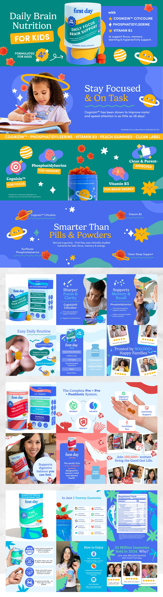

# Kids supplement listing images in cosmic green and indigo

**Discipline:** print-social · **Design type:** Product infographic set
**Tags:** e-commerce, infographic, packaging, illustration, planets, gummies, indigo-green, listing-images

## What it is
A long sheet of e-commerce listing images for a children's brain-support gummy. Panels alternate emerald green and indigo, with cartoon planets, stars and brain icons, callouts for ingredients, lifestyle photos and review-style tiles, plus three variants for teen, women's and multi products.

## What it means
Fun yet credible: cartoon space motifs signal kid-friendly, while structured callouts and ratings keep it trustworthy for parents.

## Techniques
- Build a small cast of illustrated mascots (planets, stars) that recur across every panel.
- Alternate two deep background colours to divide message blocks rhythmically.
- Label each ingredient with an icon plus benefit tag to answer questions visually.
- Mix lifestyle photography with product shots and social-proof tiles in one grid.
- Reuse the layout with a colour swap for each product variant.

## Best for
- Amazon and DTC product listings
- Health and kids' brands
- Explaining complex benefits simply

## Vocabulary
- **Listing image** — An image slot in an e-commerce product page.
- **Callout** — A label with a leader pointing out a feature.
- **Mascot system** — Repeating illustrated characters for identity.
- **Variant colourway** — Recolouring one layout for a product line.
