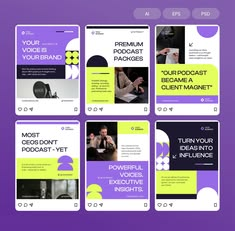

# Podcast promo set in violet with lime cutout shapes

**Discipline:** print-social ·  · **Design style:** Geometric & Bauhaus
**Tags:** podcast, templates, violet, lime, instagram, cutout-shapes, photo-crops, mockup-tiles

## What it is
A six-post Instagram preview in violet and lime, with quote headlines in bold caps, photos of hosts and microphones in dark rounded crops, and abstract lime shapes (half circles, arches) overlapping photos.

## What it means
Lively and professional; lime shapes turn stock photos into a branded look.

## Techniques
- Overlay simple flat shapes on photography to brand it.
- Alternate light and dark posts for rhythm within a set.
- Highlight a phrase with a lime block behind text.
- Show the posts inside Instagram frames with like icons.

## Best for
- Podcast and interview promotion
- Executive and B2B thought-leadership posts
- Template product listings

## Vocabulary
- **Shape overlay** — A flat coloured form laid over a photo.
- **Highlight block** — A coloured rectangle behind key words.
- **Set preview** — An overview of several designs together.
- **Arch crop** — A photo masked to a rounded-top rectangle.
