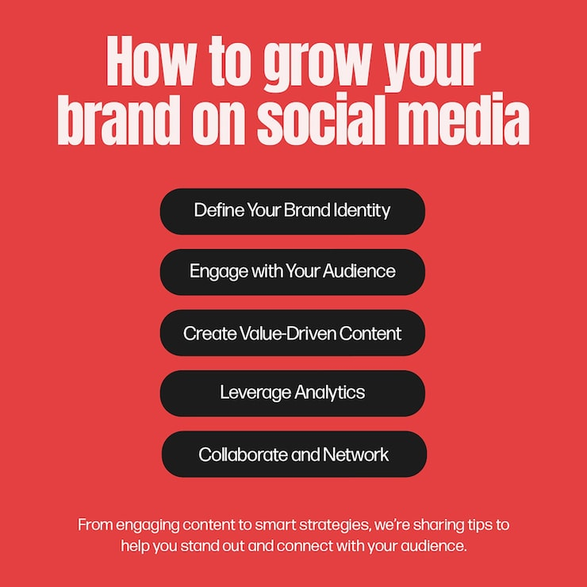

# Red Instagram carousel post with pill-shaped tip list

**Discipline:** print-social · **Design type:** Social educational post · **Design style:** Neo-Brutalist
**Tags:** instagram, social post, tips, list, bold typography, red, black

## What it is
A square social post on a flat red background with a heavy condensed headline and five black pill-shaped buttons listing brand-growth tips.

## What it means
Oversized type and stark black/white/red contrast make the advice legible and scroll-stopping without any imagery or icons.

## Techniques
- stack information in pill-shaped bars for instant scannability
- use one saturated background color as the entire visual identity
- let a condensed, heavy display font do the attention-grabbing work

## Best for
- educational carousel content
- marketing agency tip posts
- text-driven social templates

## Vocabulary
- **pill shape** — a fully rounded rectangle button commonly used to contain short list items or tags
