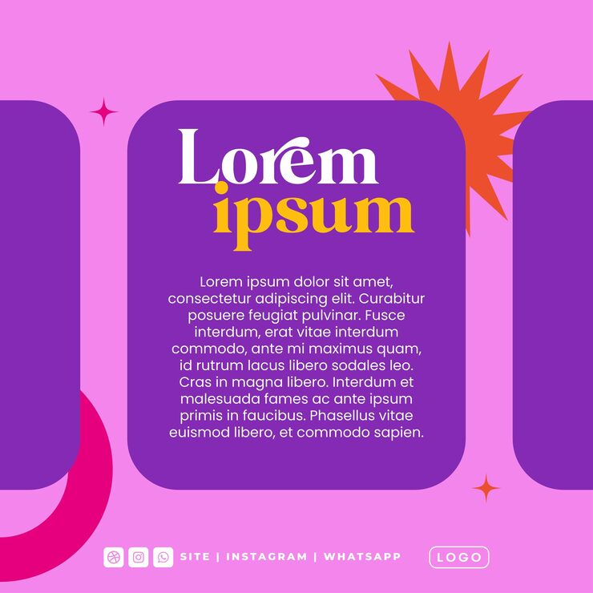

# Purple/pink post with serif headline and starburst accent

**Discipline:** print-social · **Design type:** Social promo post · **Design style:** Retro & Pixel
**Tags:** social post, serif type, starburst, purple pink, rounded panel

## What it is
A square social post on a pink background, with a rounded purple content panel holding a large serif/script mixed headline, body copy, and social icons, accented by an orange starburst shape.

## What it means
Mixing a classic serif word with a casual script word in one headline signals a brand voice that's both established and approachable, reinforced by the playful starburst accent.

## Techniques
- combine two contrasting type styles (serif + script) within one headline for personality
- use a single bold starburst shape as an eye-catching accent rather than multiple small icons
- round all panel corners generously for a soft, friendly feel

## Best for
- lifestyle or wellness brand social posts
- personal brand quote/announcement templates
- playful yet elevated social kits

## Vocabulary
- **type pairing** — the practice of combining two typefaces with contrasting qualities to add visual interest and hierarchy
