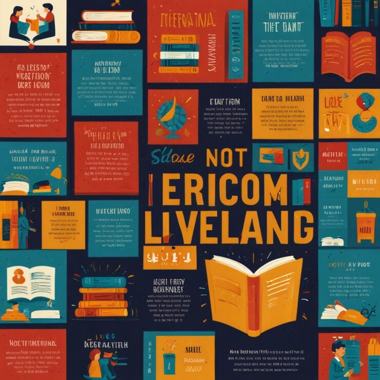

# Navy/orange collage poster with reading quote cards

**Discipline:** print-social · **Design type:** Typographic posters · **Design style:** Editorial
**Tags:** poster, collage, reading, navy orange, quote cards, typography

## What it is
A dense collage-style poster mixing navy and orange quote cards, book illustrations and hand-drawn accents, centered on a large open-book illustration and bold mixed-case headline about reading.

## What it means
A magazine-style collage of many small text/image cards around one dominant illustration mimics an editorial spread, giving a single static poster the density and browsability of a full page.

## Techniques
- arrange many small mismatched quote/text cards in a dense grid around one dominant illustration
- alternate card background colors (navy/orange/cream) for rhythm across a busy grid
- use a mix of serif, script and hand-lettered type across cards to feel curated rather than templated

## Best for
- library/literacy campaign posters
- editorial collage-style marketing
- book club or reading initiative graphics

## Vocabulary
- **collage layout** — a composition assembling many smaller distinct elements into one dense unified whole
