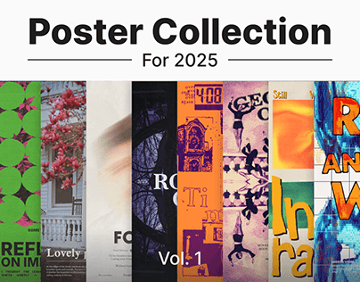

# Poster collection cover with a bold title and a fanned strip of many poster styles

**Discipline:** print-social · **Design type:** Typographic posters
**Tags:** posters, collection, cover, sans, white, strip, variety, volume

## What it is
A white cover with a heavy black 'Poster Collection' flanked by rules, 'For 2025' below, and a horizontal strip of narrow poster crops (green circles, blossom photo, blur, dark serif, orange collage, blue type) with 'Vol. 1' at the base.

## What it means
Confident and curated; a strip previews range in one glance.

## Techniques
- Show posters as narrow vertical crops.
- Use a plain heavy title.
- Add a volume label.
- Keep the cover white.

## Best for
- Poster portfolio covers
- Series volumes
- Style-range previews

## Vocabulary
- **Poster strip** — Narrow crops of many posters side by side.
- **Volume label** — A tag numbering a collection.
- **Title with rules** — A heading flanked by horizontal lines.
- **Style range** — Variety across a body of work.
