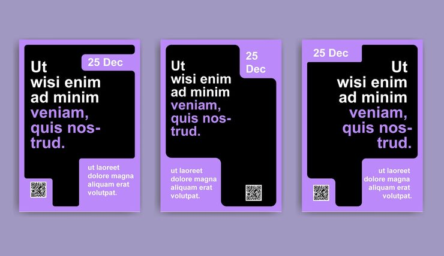

# Lavender posters with black brush-stroke photo frames

**Discipline:** print-social · **Design type:** Typographic posters · **Design style:** Minimalist
**Tags:** poster set, brush stroke, photo frame, lavender, minimal, typography

## What it is
Three near-identical lavender posters, each using a bold black brushstroke shape as an irregular frame for a placeholder photo, with a thin gold-outlined text box beneath.

## What it means
An expressive brush shape substitutes for a photo when none is available yet, so the template still feels art-directed and intentional rather than empty.

## Techniques
- use a rough brush-stroke shape as an organic alternative to a rectangular photo frame
- pair one expressive black element with one delicate thin-line gold accent for contrast
- offer near-identical layout variants so a single template feels like a flexible system

## Best for
- event or exhibition poster series
- personal brand story templates
- minimalist editorial flyers

## Vocabulary
- **brush stroke frame** — an irregular, painterly shape used in place of a geometric border to crop or contain an image
