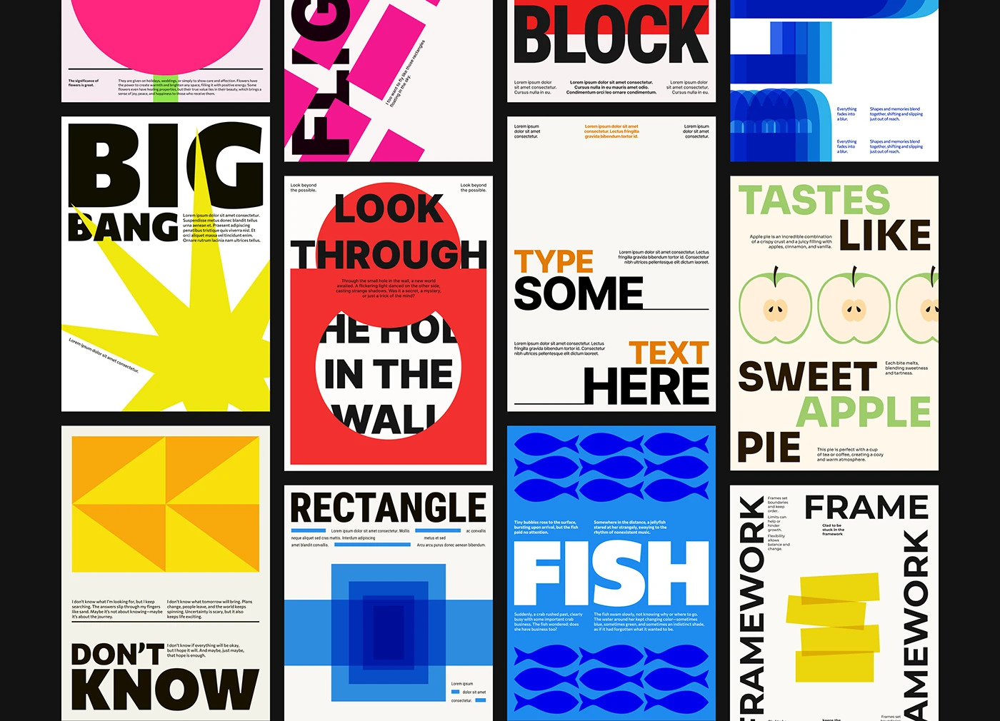

# Wall of typographic posters: BIG BANG, RECTANGLE, FISH, FRAME, LOOK THROUGH, TASTES LIKE and more

**Discipline:** print-social · **Design type:** Typographic posters
**Tags:** posters, wall, primary-colours, word-image, geometric, heavy-type, series, grid

## What it is
A black board with a wall of poster crops in a tight grid: a yellow star bursting behind BIG BANG, blue nested rectangles, blue fish pattern with FISH, yellow rectangles among FRAME and FRAMEWORK, the red hole poster, apple halves, a pink tulip, pink rectangles and more, all with heavy type and small copy.

## What it means
Playful and disciplined; each poster is a one-word idea in a shared palette.

## Techniques
- Give each poster one word and one shape.
- Keep a shared palette of primaries and cream.
- Crop tightly to create a wall.
- Use heavy grotesque with tiny body copy.

## Best for
- Poster series overviews
- Concept typography portfolios
- Word-image exercises

## Vocabulary
- **Poster wall** — Many posters shown as a tight collage.
- **One word one shape** — A rule pairing a word with a matching graphic.
- **Shared palette** — A limited colour set across a series.
- **Tight crop** — Framing posters closely.
