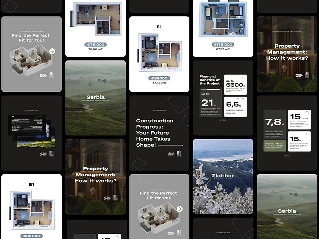

# Dark grey and white real-estate post mosaic: isometric floor plans with price pills, landscape photos and stat panels

**Discipline:** print-social ·  · **Design style:** Geometric & Bauhaus
**Tags:** real-estate, dark, grey, floor-plans, price-pills, landscape, stats, mosaic

## What it is
A masonry mosaic of square and tall posts in charcoal, grey and white: isometric apartment floor plans with a grey price pill, misty landscape photos with a place name, construction-progress and property-management text cards, large stat blocks (up to 21%, 7.8%, 15 years) and a snowy mountain photo.

## What it means
Calm and credible; muted greys and 3D plans make investment content feel structured.

## Techniques
- Show floor plans as isometric 3D on white cards.
- Add price in a grey pill.
- Mix landscape photos with text cards.
- Use large stats on dark tiles.

## Best for
- Real-estate investment social sets
- Grey and white property posts
- Mosaic overviews

## Vocabulary
- **Isometric floor plan** — A 3D angled plan of a home.
- **Price pill** — A grey capsule with a price.
- **Masonry mosaic** — Tiles of varying height interlocked.
- **Stat panel** — A panel with a big figure and caption.
