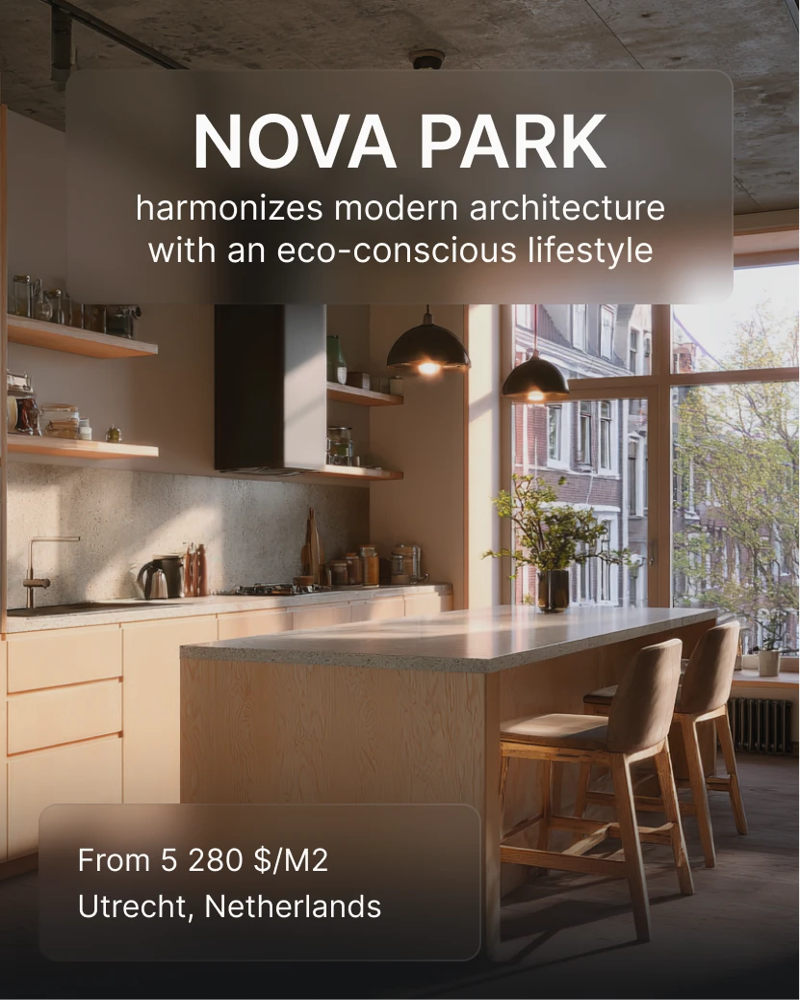

# Warm loft kitchen photo with two frosted glass panels naming the project and price

**Discipline:** print-social ·  · **Design style:** Glassmorphism
**Tags:** real-estate, interior, frosted-glass, white-text, warm, kitchen, portrait, price

## What it is
A sunlit modern kitchen with concrete ceiling, wood cabinets and a big window. A frosted rounded panel at the top holds 'NOVA PARK' in bold caps and a two-line descriptor, and a smaller panel at the bottom gives price per square metre and city.

## What it means
Warm and aspirational; glass panels keep the photo clear while text reads.

## Techniques
- Frame a heading in a frosted panel over a photo.
- Use a smaller panel for facts.
- Choose warm, well-lit interior photos.
- Keep type white and simple.

## Best for
- Property promos
- Interior-led ads
- Frosted-panel layouts

## Vocabulary
- **Frosted panel** — A blurred translucent box holding text.
- **Interior hero** — A room photo as the main image.
- **Fact panel** — A small box with price and location.
- **Warm interior light** — Golden light in a room photo.
