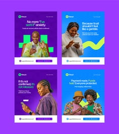

# Four purple and blue fintech ads with portraits, a green highlight and tilted phones

**Discipline:** print-social · **Design type:** Social ad set
**Tags:** fintech, ads, purple, blue, green, portraits, glass, trust

## What it is
A 2x2 set of tall ads with headlines like 'No more "I've sent it" anxiety.' and 'Because trust shouldn't feel like a gamble.' in white on saturated purple or blue, cutout portraits holding phones, glass shapes, a green squiggle and a footer with logo and URL pill.

## What it means
Reassuring and vivid; colour blocks and human portraits make trust feel warm.

## Techniques
- Alternate purple and blue backgrounds.
- Use white headlines with quoted phrases.
- Add a green squiggle accent.
- Place portraits holding a phone.

## Best for
- Payment app ad sets
- Trust-themed fintech campaigns
- Purple-blue systems

## Vocabulary
- **Colour alternation** — Ads switching between two brand colours.
- **Quoted headline** — A headline that quotes a user phrase.
- **Green squiggle** — A hand-drawn accent line.
- **Footer strip** — A base bar with logo and URL.
