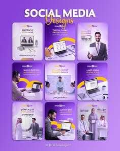

# Purple and gold professional post set with business photography and Arabic text

**Discipline:** print-social ·  · **Design style:** Corporate & Clean-Tech
**Tags:** templates, purple, gold, business, arabic, laptop, team, portfolio-cover

## What it is
A violet portfolio cover with 'Social Media Designs' in white and gold, above a 3x3 grid of purple cards with cut-out businesspeople, laptops and team scenes, gold curved swooshes and Arabic headlines.

## What it means
Corporate yet lively; violet and gold suggest premium services.

## Techniques
- Use gold swooshes across purple cards as a brand device.
- Show people with laptops as service metaphors.
- Put a gradient title on the cover with two fonts.
- Keep a consistent header and footer in each post.

## Best for
- Corporate service and consulting posts
- Arabic-language social sets
- Portfolio covers for social designers

## Vocabulary
- **Gold swoosh** — A curved golden stroke used as a device.
- **Two-font title** — A title mixing sans and script.
- **Persona cutout** — A person photo with the background removed.
- **Purple-gold pairing** — A premium colour combination.
