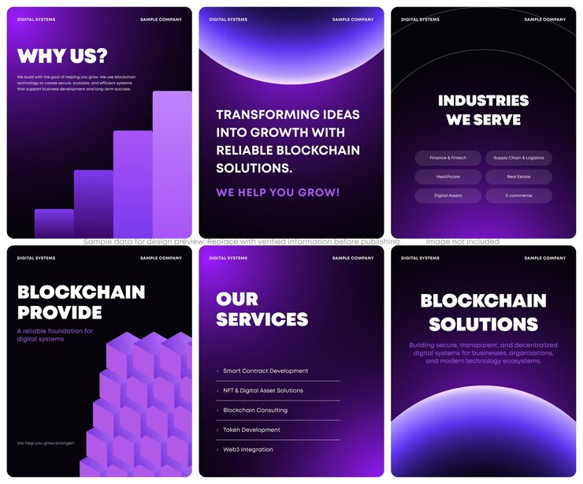

# Six black-to-purple blockchain posts with glowing planet horizons, bar charts and isometric cubes

**Discipline:** print-social · **Design type:** Social template pack · **Design style:** Gradient & Aurora
**Tags:** blockchain, web3, purple, gradient, isometric, bold-type, tech

## What it is
Six portrait posts on black fading to violet: 'Why Us?' with rising purple bars, 'Transforming ideas into growth' under a glowing planet rim, 'Industries We Serve' with pill tags, 'Blockchain Provide' with stacked isometric cubes, a services list, and 'Blockchain Solutions' above a rising glowing sphere.

## What it means
Futuristic and premium; the planet horizon glows suggest scale and a new frontier.

## Techniques
- Use a glowing planet rim as a recurring horizon.
- Stack isometric cubes to show building blocks.
- List industries as translucent pill tags.
- Set heavy uppercase headlines against deep gradients.

## Best for
- Web3 and blockchain companies
- Tech service decks
- Crypto social content

## Vocabulary
- **Planet horizon** — A large glowing arc suggesting a planet's edge.
- **Isometric** — A 3D drawing with equal angles and no perspective.
