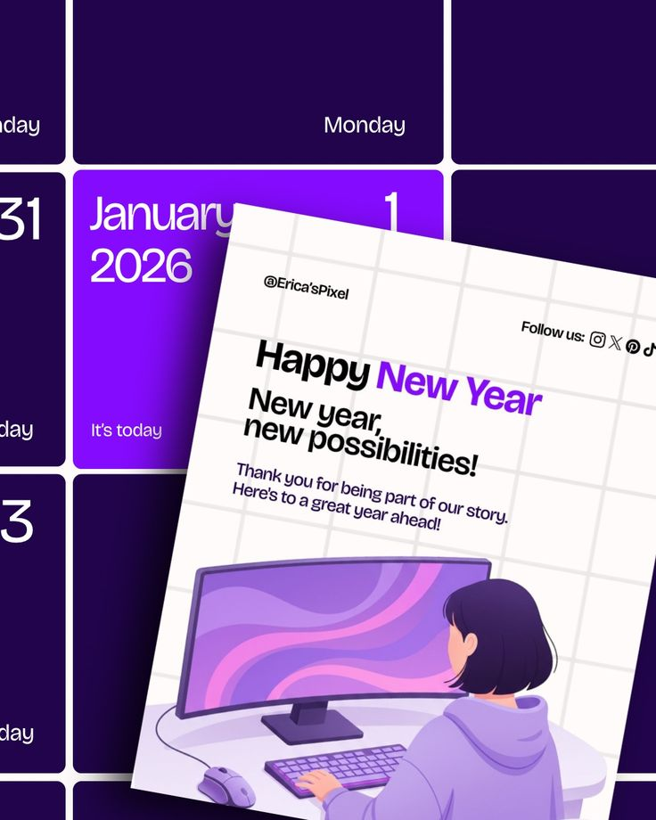

# Purple Calendar New Year Greeting

**Discipline:** print-social ·  · **Design style:** Playful & Illustrated
**Tags:** new-year, purple, calendar, illustration, tilted-card, greeting

## What it is
A portrait greeting post: a tilted grid-paper card with 'Happy New Year' (New Year in purple) and an illustration of a person at a monitor, laid over a deep purple calendar grid highlighting January 1.

## What it means
The calendar backdrop instantly says 'date' and adds a sense of a fresh start. Purple keeps it festive yet modern.

## Techniques
- Highlight a single calendar cell as the theme
- Tilted card layered on a large-scale grid
- Purple word in black headline
- Flat vector illustration in the brand palette
- Cropped grid at oversized scale

## Best for
- Holiday greetings for brands
- Studio or freelancer posts
- Calendar-themed announcements

## Vocabulary
- **Highlighted cell** — One grid or calendar cell emphasised in colour.
- **Oversized backdrop** — A pattern scaled so it is cropped and abstract.
- **Layered card** — A card tilted and placed over a separate background.
