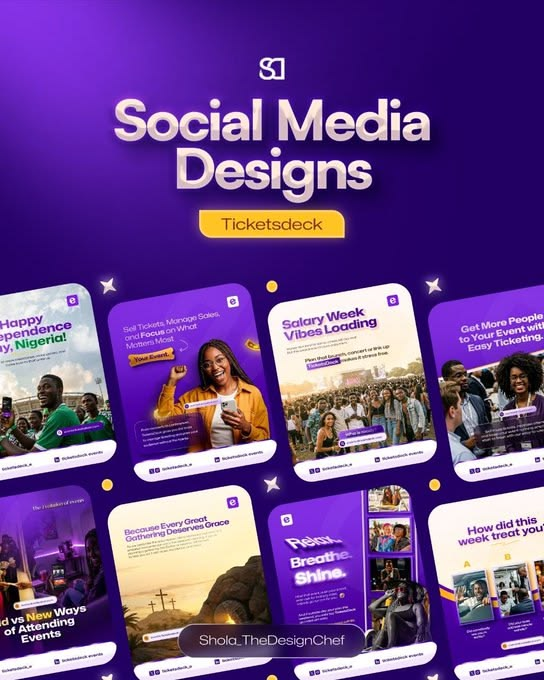

# Purple ticketing brand posts in rounded phone-like cards with yellow pill

**Discipline:** print-social · **Design type:** Social template pack
**Tags:** events, ticketing, purple, yellow, cards, photo-crops, portfolio-cover, glow

## What it is
A deep purple portfolio cover with a large cream 'Social Media Designs' title, a yellow pill naming the brand, and eight post cards in rounded corners showing crowds, portraits and event photos with purple overlays, bold headlines and white footers.

## What it means
Vibrant and communal; purple gradients and yellow accent feel like nightlife and celebration.

## Techniques
- Show posts as rounded cards fanned across the bottom of a cover.
- Highlight the client name in a yellow pill.
- Wrap photos in purple gradients for consistency.
- Use a glowing title with soft shadow.

## Best for
- Social media portfolio covers
- Event and ticketing brands
- Community-focused campaigns

## Vocabulary
- **Card fan** — Multiple posts arranged as a spread.
- **Purple wrap** — A purple gradient overlay on photos.
- **Client pill** — A capsule naming the client.
- **Portfolio cover** — A cover slide summarising a body of work.
