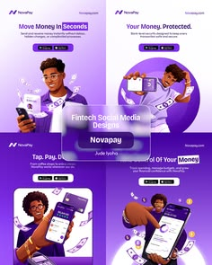

# Purple fintech ads with 3D characters holding phones

**Discipline:** print-social ·  · **Design style:** 3D & Surreal
**Tags:** fintech, social-ads, 3d-character, purple, mobile-app, glass-label, cash, app-store-badges

## What it is
Four square ads in vibrant violet. Each pairs a 3D-rendered person with a phone or cash, large white headlines like 'Move Money in Seconds', app store badges, and a frosted label in the middle naming the project.

## What it means
Energetic, friendly and youthful; a fun take on money without losing clarity.

## Techniques
- Use one saturated purple background with white type for strong contrast.
- Feature stylised 3D characters interacting with phones to show the product story.
- Float cash and coin props in the composition to add motion.
- Overlay a frosted glass label to title the set.

## Best for
- Fintech app promotions
- Youth banking ads
- Social ad creative sets

## Vocabulary
- **3D character** — A stylised rendered person or mascot.
- **Ad set** — A group of ads sharing one style.
- **Store badge** — App Store or Google Play buttons.
- **Frosted label** — A blurred translucent overlay.
