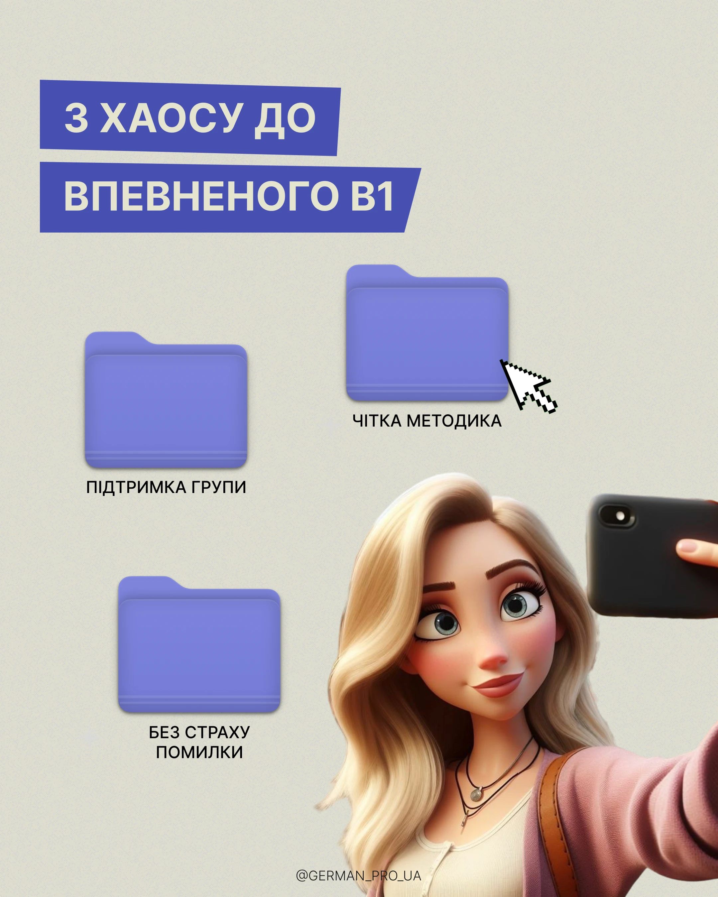

# Beige post with blue slanted banners, three lilac folders, a pixel cursor and a cartoon selfie girl

**Discipline:** print-social ·  · **Design style:** Playful & Illustrated
**Tags:** education, beige, lilac, blue-banners, folders, cursor, 3d-cartoon, cyrillic

## What it is
A grainy beige portrait with two slanted blue banners with cream caps, three big lilac desktop folders with labels, a pixel cursor pointing at one, and a 3D animated-style girl taking a selfie at the lower right, with a handle at the bottom.

## What it means
Friendly and orderly; folders turn course benefits into files.

## Techniques
- Show benefits as labelled desktop folders.
- Use a cursor to imply clicking.
- Add a cartoon character for personality.
- Keep slanted paper-like banners.

## Best for
- Course and school posts
- Benefit lists
- Desktop-metaphor covers

## Vocabulary
- **Benefit folder** — A folder icon labelling one benefit.
- **Cartoon avatar** — A 3D cartoon person as mascot.
- **Slanted banner** — A title strip with angled ends.
- **Grain paper** — A grainy beige surface.
