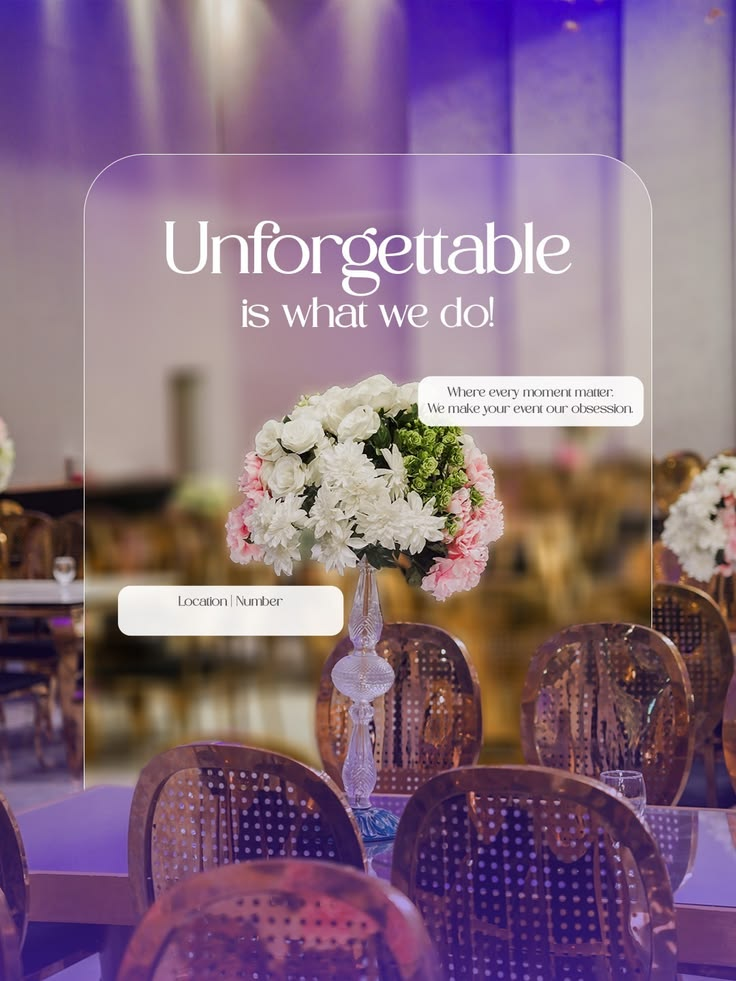

# Unforgettable Event Decor Poster with Glass Frame

**Discipline:** print-social · **Design type:** Event poster
**Tags:** events, decor, flowers, glass-frame, purple, serif, photo, poster

## What it is
A portrait event-decor poster over a purple-lit banquet hall photo with gold chairs and a floral centrepiece, framed by a thin glass-outlined panel with a light serif headline 'Unforgettable is what we do!', a tagline chip and a location chip.

## What it means
A frosted frame around the hero flowers focuses the eye, and the elegant serif and purple light feel celebratory.

## Techniques
- Thin translucent outline frame around the focal area
- Elegant light serif headline
- Rounded white text chips for the tagline and contact
- Purple-tinted photography
- Focal flowers positioned in the frame centre

## Best for
- Event planning and decor brands
- Wedding and banquet promotions
- Photo-led elegant posters

## Vocabulary
- **Glass outline** — A thin translucent border used to frame part of an image.
- **Info chip** — A small rounded box holding a line of details.
- **Tinted photo** — A photo lit or graded in one colour.
