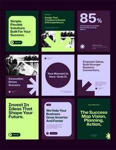

# Deep purple and lime business posts with bold quote cards

**Discipline:** print-social · **Design type:** Social template pack
**Tags:** templates, purple, lime, business, quote-cards, arrows, grid, sans-serif

## What it is
A 3x3 grid of square post templates in dark purple, lime and lavender with bold sans headlines, big star and arrow glyphs, a large '85%' stat and some duotone photo tiles.

## What it means
Modern, confident consulting energy; lime is the highlight in an otherwise dark set.

## Techniques
- Alternate solid colour cards with photo tiles in a single palette.
- Use huge simple glyphs (arrows, star) as graphic anchors.
- Set headlines in heavy grotesque with one line highlighted.
- Include a large stat card to vary the rhythm.

## Best for
- Business, coaching and consulting social accounts
- Template packs for social managers
- Thought-leadership content

## Vocabulary
- **Template pack** — A set of reusable post layouts.
- **Duotone photo** — A photo tinted with two colours.
- **Glyph anchor** — A large symbol used as the main graphic.
- **Stat card** — A post built around one large number.
