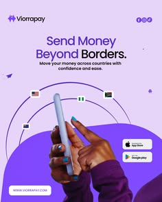

# Lilac money-transfer ad with a hand holding a phone under arcs linking country flags, and store badges

**Discipline:** print-social · **Design type:** Social ad
**Tags:** fintech, ad, lilac, purple, flags, orbit, hand, app-badges

## What it is
A lilac portrait ad with a logo, headline 'Send Money Beyond Borders.' with 'Borders' in violet, a hand with teal nails holding a phone below thin orbit arcs connecting five country flags, a big violet curve at the bottom and App Store and Google Play badges plus a URL pill.

## What it means
Friendly and global; the orbit arcs show money travelling.

## Techniques
- Link flags with thin orbit arcs.
- Colour one headline word violet.
- Use a large curve as a base.
- Add store badges and URL.

## Best for
- Remittance and payment app ads
- Global money transfer
- Purple fintech brands

## Vocabulary
- **Orbit arc** — A thin curved line linking nodes.
- **Flag node** — A small flag icon on an arc.
- **Base curve** — A big curve anchoring the bottom.
- **Store badge** — An app store download button.
