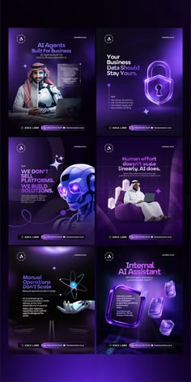

# Six purple neon AI-service posters with robot, lock and glass shapes

**Discipline:** print-social · **Design type:** Social template pack
**Tags:** ai, agency, purple, neon, 3d-objects, robot, lock, poster-set

## What it is
A vertical presentation of six poster-style posts with deep purple gradients and glowing violet accents. Each has a 3D or rendered hero (a lock, a robot head, atomic symbol and hand, glass cubes) plus a bold white headline and small CTA chips.

## What it means
Techy and premium; glow makes the AI subject feel powerful and high-value.

## Techniques
- Render a single glossy object per post as the metaphor.
- Keep the same purple gradient and glow across the set.
- Use big white headlines with one bright accent word.
- Add a slim CTA pill bar at the bottom of each.

## Best for
- AI and software agency social sets
- Tech B2B posts
- Explaining abstract services with objects

## Vocabulary
- **Neon glow** — A luminous edge or halo in a saturated colour.
- **Hero object** — A single rendered symbol representing the message.
- **CTA bar** — A strip at the bottom holding action text.
- **Gradient set** — Posts sharing the same background gradient.
