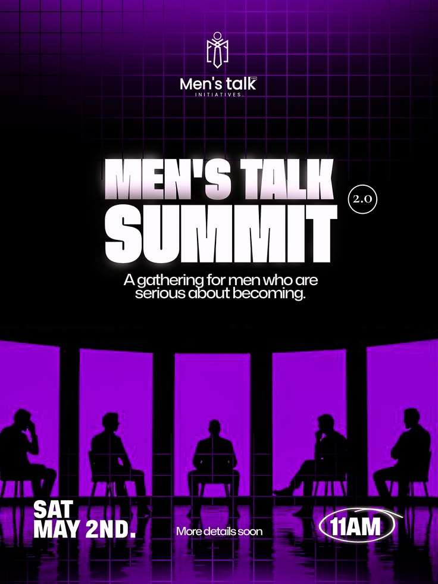

# Purple Neon Summit Poster with Silhouettes

**Discipline:** print-social ·  · **Design style:** Dark & Neon
**Tags:** summit, purple, neon, silhouettes, grid, reflection, white-glow-type, poster

## What it is
A black and purple event poster with a grid-lit top, a logo, glowing white heavy title 'MEN'S TALK SUMMIT' with a 2.0 circle, a tagline, and a row of seated silhouettes against glowing purple windows with reflections, and the date, 'More details soon' and a circled 11AM.

## What it means
Silhouettes against purple light suggest conversation and depth, and the glowing title gives it gravitas.

## Techniques
- Silhouettes against glowing coloured windows
- Glowing white heavy title on black
- Reflection on a glossy floor
- Grid lines fading down from the top
- Hand-drawn circle around the time

## Best for
- Talk and summit event posters
- Dark neon flyers
- Group discussion imagery

## Vocabulary
- **Silhouette scene** — People shown only as dark shapes against a light.
- **Glow type** — Lettering with a soft outer glow.
- **Floor reflection** — A mirrored image of elements on a glossy floor.
