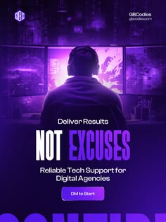

# Dark purple tech-support ad with a gamer silhouette, two-tone caps headline and a cropped word

**Discipline:** print-social · **Design type:** Social ad
**Tags:** tech, ad, purple, neon, silhouette, condensed-caps, cta-pill, dark

## What it is
A dark violet post with a logo, a person with headphones seen from behind facing monitors, 'Deliver Results' in light type, giant white and violet condensed caps 'NOT EXCUSES', a short line and a glowing 'DM to Start' pill, with a huge cropped word at the bottom.

## What it means
Bold and no-nonsense; neon purple on dark says technical competence.

## Techniques
- Use a back-view silhouette facing glowing screens.
- Set a two-tone condensed headline.
- Crop a giant word at the base.
- Keep one glowing CTA pill.

## Best for
- Tech-support and dev-agency ads
- Dark neon social posts
- Punchy B2B messaging

## Vocabulary
- **Back-view silhouette** — A figure seen from behind.
- **Two-tone headline** — A headline in two colours.
- **Cropped base word** — A giant word cut by the bottom edge.
- **Glow pill** — A button with a soft luminous edge.
