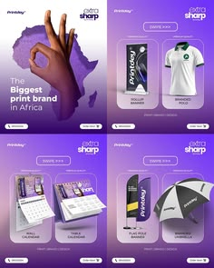

# Purple print-brand promo set with product cards and glass panels

**Discipline:** print-social ·  · **Design style:** Glassmorphism
**Tags:** print-shop, promo, purple, glass-panels, product-grid, merchandise, banner, social-ads

## What it is
Four purple gradient posts for a printing company: one with a hand forming an OK sign over a map of Africa, three with translucent panels holding product images (rollup banner, polo, calendars, flag banner, umbrella) and labels.

## What it means
Bold and commercial yet neat; glass panels present products like a catalogue.

## Techniques
- Show products inside frosted glass panels on a gradient.
- Use a hand gesture cut-out as the hero for the brand message.
- Repeat a two-panel layout for product sets.
- Include logo and CTA bar in each post.

## Best for
- Print shops and merchandise brands
- Product catalogue social posts
- Regional brand campaigns

## Vocabulary
- **Glass panel** — A translucent frosted rectangle over a gradient.
- **Catalogue post** — A post showing several products with labels.
- **Gesture cutout** — A hand pose cut out as a symbol.
- **Regional map motif** — A country or continent silhouette used as graphic.
