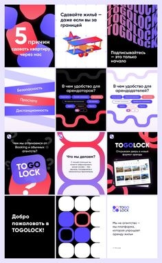

# Small mosaic of bold blob-shaped posts for a rental platform in violet, red, black and white

**Discipline:** print-social ·  · **Design style:** Geometric & Bauhaus
**Tags:** rental, platform, violet, red, black, blob-shapes, waves, russian

## What it is
A small pin preview of twelve square posts with thick wavy stripes, blobs, a big violet logo bubble 'TOGOLOCK', red and purple ribbons, black cards with chips and a 3D toy plane, mixing violet, red, black and white.

## What it means
Playful and energetic; thick shapes make property tech feel friendly.

## Techniques
- Use fat blobs and wavy stripes as graphics.
- Mix violet, red, black and white cards.
- Add a 3D toy object.
- Keep chips for benefits.

## Best for
- Rental and proptech posts
- Bold shape systems
- Colourful startup feeds

## Vocabulary
- **Wavy stripe** — A thick wavy band as a pattern.
- **Logo bubble** — A logo inside a rounded blob.
- **Benefit chip** — A small pill listing a benefit.
- **Shape system** — A set of recurring graphic shapes.
