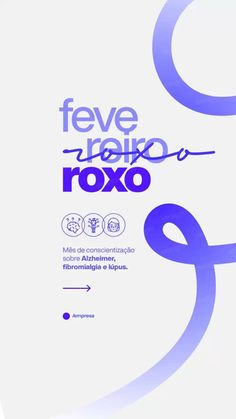

# Awareness post with a giant lilac ribbon loop, a struck-through month name and three brain icons

**Discipline:** print-social ·  · **Design style:** Minimalist
**Tags:** awareness, lilac, ribbon, strikethrough, white, minimal, health, portuguese

## What it is
A pale portrait with a huge lilac ribbon loop crossing from the top right to the bottom, a headline 'fevereiro roxo' in lilac and dark violet where 'roxo' is struck through by a hand-drawn line, three circular brain-icon badges, a short description, a thin arrow and a small brand dot.

## What it means
Gentle and purposeful; the ribbon is the symbol and the scribble adds warmth.

## Techniques
- Use a giant ribbon shape as the hero.
- Strike through a word with a handwritten line.
- Colour text in two purples.
- Add three small icons for topics.

## Best for
- Health awareness campaigns
- Minimal symbol-led posts
- Lilac campaigns

## Vocabulary
- **Awareness ribbon** — A looped ribbon symbol for a cause.
- **Handwritten strike** — A scribble line through a word.
- **Icon badge** — A small circular icon.
- **Two-purple type** — Text in lilac and dark violet.
