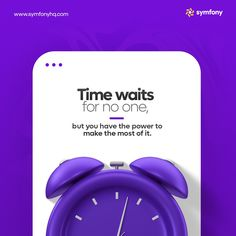

# Violet quote card 'Time waits for no one' with a violet 3D alarm clock rising from the bottom

**Discipline:** print-social ·  · **Design style:** 3D & Surreal
**Tags:** quote, violet, 3d-render, alarm-clock, white-card, minimal, business, square

## What it is
A violet square with a small URL and logo, a white rounded card with three dots at the top and a quote 'Time waits for no one, but you have the power to make the most of it.' with a short underline, and a glossy violet alarm clock cropped at the bottom.

## What it means
Bold and simple; a clock render turns a quote into a visual reminder.

## Techniques
- Put the quote on a white window-like card.
- Use a monochrome 3D object matching the background.
- Crop the object at the bottom.
- Underline a short accent line.

## Best for
- Quote and motivation posts
- Monochrome 3D social graphics
- Violet brands

## Vocabulary
- **Window card** — A white card styled like a window with dots.
- **Monochrome 3D** — A 3D object in the same hue as the backdrop.
- **Cropped object** — An object cut by the frame edge.
- **Accent underline** — A short line under a heading.
